# PID con anti-windup en Simulink, HDL Coder y FPGA-in-the-Loop

Este ejemplo presenta el diseño de un controlador PID discreto con anti-windup en MATLAB/Simulink y su conversión a HDL mediante HDL Coder. Las ganancias proporcional, integral, derivativa y de anti-windup son entradas externas, por lo que pueden ajustarse sin modificar la estructura del controlador.

Mediante HDL Verifier se valida el controlador en una FPGA usando FPGA-in-the-Loop (FIL), con una planta en lazo cerrado en Simulink. Esto permite comparar su respuesta con la del modelo de Simulink ante cambios de referencia, saturación del actuador y ajustes de parámetros.

## Requisitos

- MATLAB/Simulink R2025b Update 2 (`2025.2`)
- HDL Coder
- HDL Verifier
- Vivado `2023.1`

## Inicio rápido

1. Abrir el modelo `PID_antiwidup.slx` en MATLAB.
2. Verificar que el controlador utilice tipos de datos en punto fijo `fixdt(1,64,26)` en entradas y señales principales.
3. Ejecutar la simulación del lazo cerrado en Simulink.
4. Generar el HDL del subsistema PID con HDL Coder.
5. Crear el bloque FIL con HDL Verifier y configurar la compilación en Vivado `2023.1`.
6. Ejecutar la co-simulación FPGA-in-the-Loop y comparar la respuesta con la simulación base.

## Estructura del controlador

El controlador emplea anti-windup por retrocálculo y calcula la acción derivativa a partir de la medición de la planta. El error es $e[k]=r[k]-y[k]$, donde $r[k]$ es la referencia e $y[k]$ la salida medida. El período de muestreo es $T_s=10^{-4}\,\mathrm{s}$, equivalente a una frecuencia de 10 kHz.

### Parte proporcional

El bloque `Proporcional_gain` multiplica el error por la ganancia proporcional:

$$
P[k] = K_p \cdot e[k]
$$

Este término responde de forma inmediata al error actual y no introduce memoria en el sistema.

### Parte integral con anti-windup

El bloque `I_component` acumula el error e incorpora la corrección por anti-windup:

$$
I[k] = I[k-1] + (K_i e[k] + K_{aw} (u_{sat}[k] - u[k])) T_s
$$

Aquí $u[k]$ es la salida del controlador y $u_{sat}[k]$ la señal aplicada por el actuador. La diferencia entre ambas corrige la acumulación integral durante la saturación. `Unit Delay 1` almacena el valor anterior de la integral.

### Parte derivativa

El bloque `D_component` calcula la derivada negativa de la medición. Como la ganancia $K_d$ es una entrada externa y se multiplica por la medición antes del retardo, la expresión general es:

$$
D[k] = \frac{K_d[k-1]y[k-1] - K_d[k]y[k]}{T_s}
$$

Para una ganancia derivativa constante, se reduce a:

$$
D[k] = -K_d\frac{y[k]-y[k-1]}{T_s} = -10^4 K_d\left(y[k]-y[k-1]\right)
$$

Esta estructura evita el impulso derivativo causado directamente por un cambio brusco de referencia. Un cambio brusco de $K_d$ también puede producir un transitorio, porque `Unit Delay 2` almacena el producto anterior de la ganancia y la medición.

### Suma final y saturación

Las tres componentes se suman para obtener la señal previa al retardo de salida:

$$
v[k] = P[k] + I[k] + D[k]
$$

El bloque `Unit Delay 3` introduce un retardo de una muestra, de modo que $u[k]=v[k-1]$. La salida pasa por el actuador saturado:

$$
u_{sat}[k] = \min\left(u_{max},\max\left(u_{min},u[k]\right)\right)
$$

La diferencia $u_{sat}[k]-u[k]$ se realimenta al integrador para el anti-windup. El retardo de salida debe considerarse al comparar las respuestas en Simulink y FIL.

Modelo PID con anti-windup en Simulink:

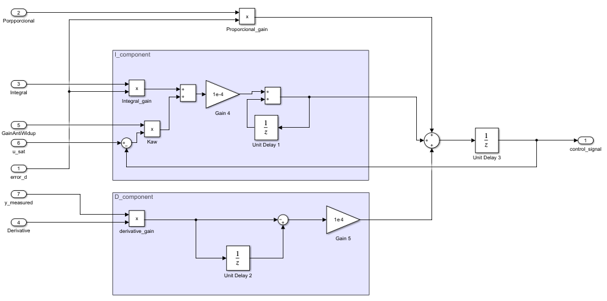

## Implementación en punto fijo

Para la generación de HDL es necesario que todas las entradas y bloques aritméticos trabajen con tipos enteros o de punto fijo (`int`, `fixdt` o `logical`). En este ejemplo se utilizan:

- `fixdt(1,64,26)` para entradas y señales principales.
- `fixdt(1,36,26)` para sumadores y multiplicadores.

Esto deja 10 bits para la parte entera y 26 bits para la parte fraccionaria, una distribución razonable para señales de control con amplitud moderada y necesidad de buena resolución decimal.

También se habilita la opción `Saturate on overflow` para evitar desbordamientos que alteren el signo o introduzcan saltos no deseados en la dinámica del controlador.

Configuración de tipos de datos y saturación en sumadores:

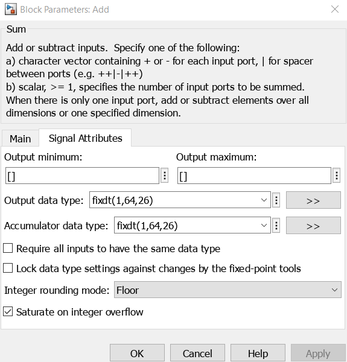

Configuración de tipos de datos y saturación en multiplicadores:

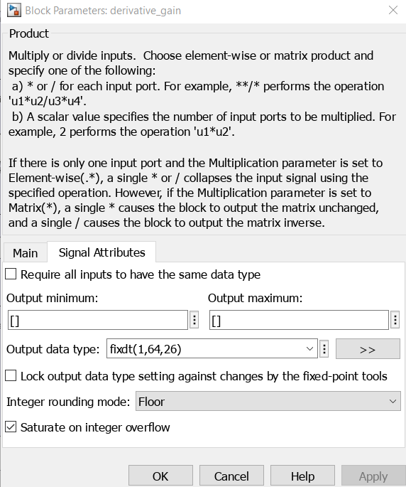

Subsystem del PID en Simulink:

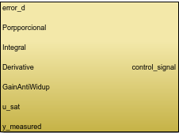

## Lazo cerrado de validación

Una vez definido el subsistema del controlador, se construye un lazo cerrado para evaluar su respuesta.

Lazo cerrado en Simulink con actuador y planta:

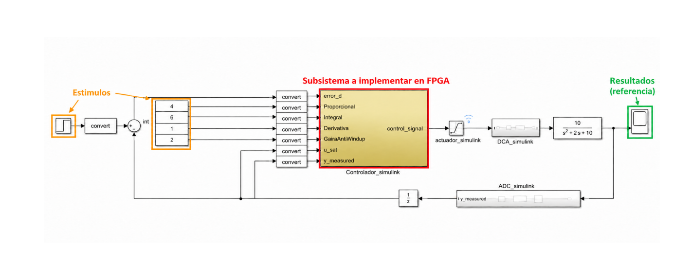

El actuador se modela mediante una saturación de $\pm 10$ y la planta mediante la función de transferencia:

$$
G(s) = \frac{10}{s^2 + 2s + 10}
$$

Consideraciones principales:

- El PID es discreto, por lo que las entradas deben discretizarse con un `Zero-Order Hold` cuyo período sea igual a `Ts = 1e-4`.
- Como Simulink opera de forma nativa en `double`, se utiliza un bloque `Data Type Conversion` antes del controlador para convertir a `fixdt(1,64,26)`.
- Entre el sistema discreto y la planta continua se usa un `Zero-Order Hold` y una conversión a `double`, emulando un DAC.
- En la realimentación de la planta hacia el controlador se usa un `Zero-Order Hold` y una conversión de `double` a `fixdt(1,64,26)`, emulando un ADC.
- La salida del actuador también se adapta mediante bloques de conversión y retención para mantener consistencia temporal y de tipo.

Para el controlador se emplean los parámetros $K_p = 2$, $K_i = 6$, $K_d = 1$, $K_{aw} = 2$ y $T_s = 1 \times 10^{-4}$. Con esta configuración se obtiene la siguiente respuesta en 15 segundos, usando una referencia de amplitud 2 aplicada después del segundo 2.

Respuesta del control PID con anti-windup en Simulink:

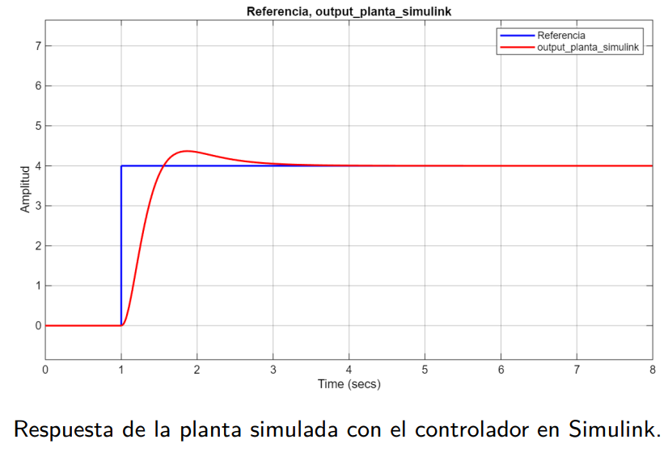

## Generación de HDL

El siguiente paso consiste en traducir el diseño de Simulink a HDL mediante el flujo de HDL Coder.

Aunque Simulink permite generar HDL a partir de tipos de punto flotante, esa opción suele consumir muchos más recursos y requerir más ciclos en FPGA. Por esa razón, el ejemplo principal se desarrolla en punto fijo. Aun así, se incluye una comparación con una configuración en punto flotante.

Para usar punto flotante se abre `HDL Coder` desde `Apps`, se entra a la configuración global y se ajustan los siguientes parámetros:

- En `Global settings`, aumentar el `oversampling` por encima del valor por defecto. En este caso se utiliza 100, aunque el diseño requiere aproximadamente 78.
- Activar `Use floating point`.

Configuración de oversampling en HDL Coder:

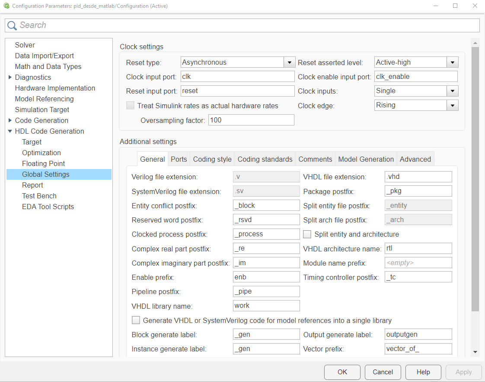

Habilitación de punto flotante:

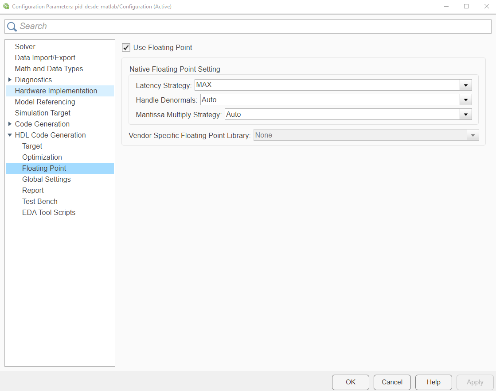

## Comparación entre punto fijo y punto flotante

Como referencia, se muestra la diferencia de utilización de recursos entre ambas implementaciones.

Utilización con punto fijo:

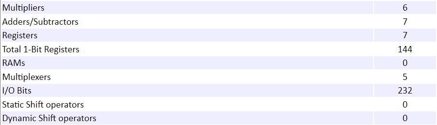

Utilización con punto flotante:

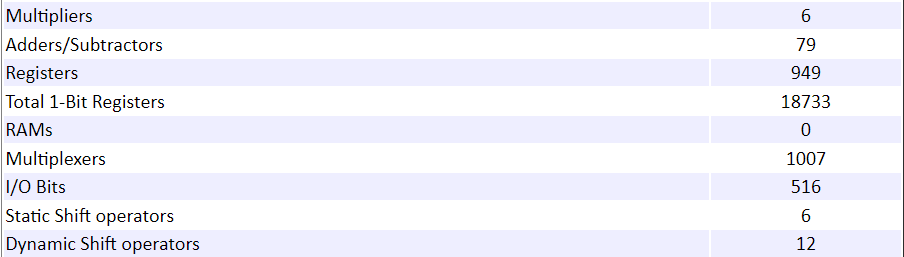

La implementación en punto flotante demanda significativamente más recursos que la versión en punto fijo. Para generar HDL con punto flotante, todos los bloques deben trabajar en `single` o `double`. Para una implementación en punto fijo, todos los bloques deben ser compatibles con tipos enteros o fijos como `int`, `fixdt`, `fi` o `logical`.

Subsystem creado para la generación de HDL:

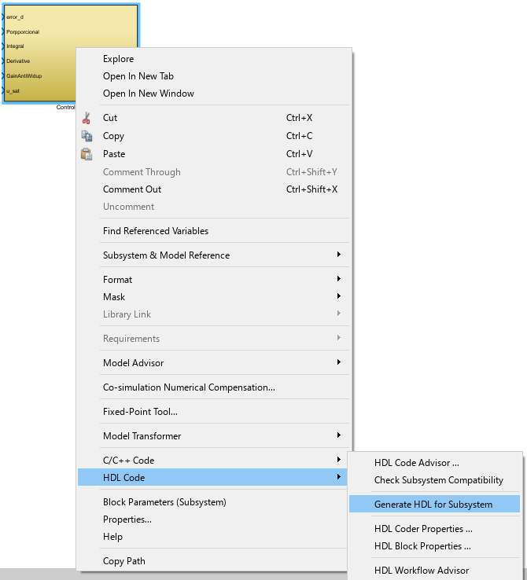

Este paso genera los archivos HDL en la carpeta del proyecto, normalmente en `hdlsrc/ProjectName/Nombre_Bloque.vhd` o `.v`, según el lenguaje configurado.

## Generación del bloque FIL

Una vez generado el HDL, se utiliza `FIL Wizard` con una configuración estándar para crear el bloque FIL del PID.

Bloque FIL generado para el PID:

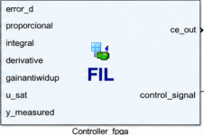

Con ese bloque se reconstruye el lazo cerrado usando la misma parametrización que en la simulación base.

Lazo cerrado con bloque FIL en co-simulación:

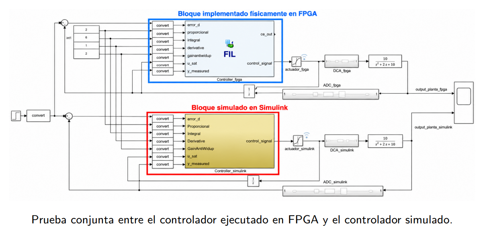

## Resultados de co-simulación

Se compara la salida de la planta en la simulación de Simulink con la obtenida al ejecutar el controlador en la FPGA mediante FIL. Ambas respuestas permiten evaluar la consistencia del comportamiento del controlador en lazo cerrado.

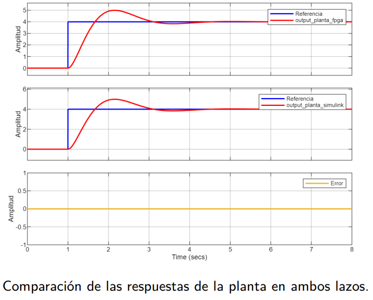

Las salidas de la planta para el controlador en Simulink y el controlador en FPGA coinciden, con error cero en la comparación realizada.

## Conclusiones y consejos prácticos

El ejemplo recorre el flujo desde un controlador discreto en Simulink hasta su ejecución en FPGA mediante HDL Coder y HDL Verifier. Para las condiciones evaluadas, la comparación de la salida de la planta mostró error cero entre Simulink y FIL. Este resultado corresponde a la prueba presentada y conviene repetirlo si se modifica el modelo o la configuración.

Para reproducir la comparación:

- Usar la misma referencia, planta, límites del actuador y ganancias en ambos lazos.
- Mantener coherentes el período de muestreo, los tipos de datos y las conversiones entre Simulink y el bloque FIL. Considerar también el retardo de una muestra del controlador.
- Si se modifica el subsistema del controlador, regenerar el HDL y el bloque FIL para que la FPGA ejecute la versión actualizada.
- Comparar las señales con la misma escala y alineación temporal, y revisar la señal de error además de las curvas de salida.

Las guías de `HDL_coder/` y `HDL_Verifier/FIL/` del repositorio complementan este ejemplo con detalles sobre generación HDL y verificación en FPGA.
